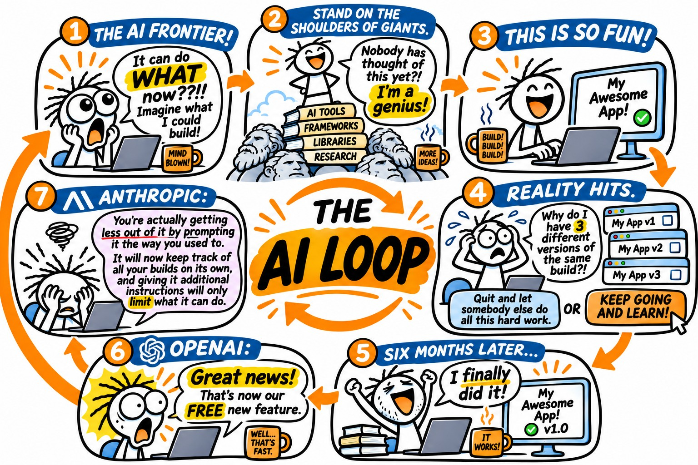

# If I Could, Would You?

Where I find out what I can do, then find out if I can teach it away, in a way, that inspires others.

## Issue #3: The Loop

### Introduction:

When deciding what to make this week's lesson about, my mind, as so often is the case, ran in a few different directions at once. Context management seemed like a natural continuation of the basics we covered last week. I also considered making this week the week I walk the non-initiated from zero to vibe coding. I even pondered making it about security which is quickly becoming that saucepan I forgot to stir until I smelled something burning because I was too busy watching the steaks cook.

But then, out of curiosity, and not a small amount of imposter syndrome, I asked ChatGPT if it could find my old code I wrote in college in my Gmail account. And unlike Gemini, who is supposed to be having intimate relations with Gmail, but just can't seem to bring them to a satisfying conclusion, ChatGPT found them right away. They're now up in my GitHub if you're [interested](https://github.com/stevenammer/before-the-vibes).

And as I read through my projects and saw my thinking in the code, it made me realize why I fell in love with this stuff all those years ago.

You see, I had a brilliant professor at a little old community college named [Dennis Hunchuck](https://www.linkedin.com/in/dennis-hunchuck-7a748a56/) who had a wicked sense of humor that I've always been a sucker for and a way of explaining things that made you feel both silly if you didn't get it the first time, yet somehow totally okay asking him to explain it again. And Dennis taught me about my first loop.

### The Lesson:

If you have been trying to keep up with AI in the last few months or so, I'm sure you've seen increasing use of the word "loop." Every Claude Consultant wants to tell you about their "closed loop system" or their "human in the loop" or you'll see a LinkedIn post with a confusing graphic of loops that don't seem to actually mean much of anything. Then the ["creator of Claude Code himself"](https://www.linkedin.com/in/bcherny) comes out and says he no longer writes prompts, now he writes loops, and every "prompt engineer" became a "loop engineer" overnight.

You know, you hear a word enough times in enough increasingly different places and you start losing track of what the word actually means in the first place.

A loop... Is a circle. It goes round and round and repeats itself forever. That's it. In programming, (if you're doing it right) it's a circle with an off ramp.

When I first started to learn to code, I felt so powerful. It was like learning some secret agent language to talk to computers with, but my professor warned me: these computers can't think. They are going to do exactly what you tell them to. If you mess up an instruction or say it in a way they don't understand, they are going to mess up the execution.

Seems pretty obvious when you think about it, but for me, this was a revelation! Because, if the flip side was true, I could take my time, catch every error before I tried to run it, and even if I somehow let a mistake slip through, I could fix it just by following the logic of what I told it to do. Or by going line by line looking for "syntax errors," not at all unlike my *actual* word search strategy when I just can't find a word.

To a guy who had spent most of his career trying to turn firm nos to excited yeses without any clear indication of what they were actually thinking or why this one hung up on me or why that one gave me the card... well the idea of that kind of honest interaction was therapeutic.

And then he got me again. He taught the lesson on my first loop. And my mind about exploded with the possibilities. Now I could use up all my brain power on solving a big interesting problem once and then repeat it over and over again as many times as I needed without ever having to lift another finger. If I thought smart enough, I could skip writing lines and lines of code. Finally something would reward me for figuring out the assignment and skipping the busy work. Work smarter not harder, but with real margins!

### The Actual Code (I know, I know, hang in there with me!)

I'll give you an example and instead of going shallower for better understanding like I normally would, I'm gonna take the path less traveled and make this more complicated and start showing you \*gasp\* actual code. You see, I needed to get the words from the user for my word search generator. I could have just made each new word a whole new line. It would have taken me forever, but it would have been straightforward, required little thinking, and it would have worked. It would have looked like this:

Without a loop (illustrative alternative, not my original code):

```c
if (numberOfWords >= 1) {
    printf("Enter word 1:");
    scanf("%19s", words[0]);
}
if (numberOfWords >= 2) {
    printf("Enter word 2:");
    scanf("%19s", words[1]);
}
if (numberOfWords >= 3) {
    printf("Enter word 3:");
    scanf("%19s", words[2]);
}
if (numberOfWords >= 4) {
    printf("Enter word 4:");
    scanf("%19s", words[3]);
}
if (numberOfWords >= 5) {
    printf("Enter word 5:");
    scanf("%19s", words[4]);
}
if (numberOfWords >= 6) {
    printf("Enter word 6:");
    scanf("%19s", words[5]);
}
if (numberOfWords >= 7) {
    printf("Enter word 7:");
    scanf("%19s", words[6]);
}
if (numberOfWords >= 8) {
    printf("Enter word 8:");
    scanf("%19s", words[7]);
}
if (numberOfWords >= 9) {
    printf("Enter word 9:");
    scanf("%19s", words[8]);
}
if (numberOfWords >= 10) {
    printf("Enter word 10:");
    scanf("%19s", words[9]);
}
if (numberOfWords >= 11) {
    printf("Enter word 11:");
    scanf("%19s", words[10]);
}
if (numberOfWords >= 12) {
    printf("Enter word 12:");
    scanf("%19s", words[11]);
}
if (numberOfWords >= 13) {
    printf("Enter word 13:");
    scanf("%19s", words[12]);
}
if (numberOfWords >= 14) {
    printf("Enter word 14:");
    scanf("%19s", words[13]);
}
if (numberOfWords >= 15) {
    printf("Enter word 15:");
    scanf("%19s", words[14]);
}
if (numberOfWords >= 16) {
    printf("Enter word 16:");
    scanf("%19s", words[15]);
}
```

Now, I know people see code and their eyes just go unfocused, but look closely... Do you see a pattern?

How about now?

```text
If they asked for at least 1 word: ask for word 1, then save it in spot 0.
If they asked for at least 2 words: ask for word 2, then save it in spot 1.
If they asked for at least 3 words: ask for word 3, then save it in spot 2.
If they asked for at least 4 words: ask for word 4, then save it in spot 3.
If they asked for at least 5 words: ask for word 5, then save it in spot 4.
If they asked for at least 6 words: ask for word 6, then save it in spot 5.
If they asked for at least 7 words: ask for word 7, then save it in spot 6.
If they asked for at least 8 words: ask for word 8, then save it in spot 7.
If they asked for at least 9 words: ask for word 9, then save it in spot 8.
If they asked for at least 10 words: ask for word 10, then save it in spot 9.
If they asked for at least 11 words: ask for word 11, then save it in spot 10.
If they asked for at least 12 words: ask for word 12, then save it in spot 11.
If they asked for at least 13 words: ask for word 13, then save it in spot 12.
If they asked for at least 14 words: ask for word 14, then save it in spot 13.
If they asked for at least 15 words: ask for word 15, then save it in spot 14.
If they asked for at least 16 words: ask for word 16, then save it in spot 15.
```

Almost seems like the kind of thing you would see Bart Simpson writing on a blackboard. It even looks like a punishment.

But because I had discovered this new super power called looping and had a serious aversion to tedious, unnecessary work, I decided to write this instead:

My actual code from February 2014:

```c
void getWords(char words[][20], int numberOfWords) {
    int count = 0;
    char userWord [20];
    do {
        cls;
        printf("Enter word %i:", count + 1);
        scanf("%s", userWord);
        flush;
        printf("You entered %s. \n", userWord);
        enterUserWord(words, userWord, count);
        count++;
    } while (count < numberOfWords);
    return;
}
```

I know, I know, still scary code, but at least you can look at it long enough to see what the actual words are. I'll give it the same treatment:

```text
Collect words. This takes the empty list and how many words to collect.
    Start a counter at 0.
    Make a small box to hold the word being typed.
    Begin the circle. Everything down to the last check repeats.
        Clear the screen.
        Ask for word number counter + 1.
        Wait for a typed word and put it in the box.
        Clear out leftover keystrokes.
        Show them what we heard.
        Put the word in that spot of the list.
        Add 1 to the counter.
    Is the counter still less than the number of words? If yes, back to the top. If no, leave the circle.
    Done. Hand control back.
End.
```

Seems like a much easier way to get your point across, huh? That's all a loop is. It's as simple as it is powerful. What could go wrong?

Well, here is another example of my super amazing meat fingers clicking away:


```c
char doesItFit = 'N';
do {
    do {
        chooseDirection(&direction);
        chooseSpotinGrid(&spotInGridI, &spotInGridJ);
        // ...(eight tries trimmed here, one per direction, each handed doesItFit)...
    } while (doesItFit = 'N'); //End inner do while.
    count++;
} while (count < numberOfWords); //End outer do while.
```

I'm not even gonna bother translating this one guys. Look at the highlighted portion. 

You see that = there? Most people would read that as "Equals." Most people, including me when I wrote it, would be wrong. That, in computer speak, means "gets." Which just means that whatever thing you're referring to gets changed into whatever you say next. So instead of me creating a loop that only continues round and round while the answer to my question is still no, my loop started each trip around by setting the answer to no, so there was no escape and it would continue to loop around time and time again until every one of us is [devoured by the bloodthirsty jaws of inescapable death!](https://clip.cafe/moana-2016/the-ocean-chose-you/t/156)

As you can see loops can be scary powerful!

How powerful you ask? Let's see what happens when you put an AI in the loop.

Well, let me peel back the curtain first on all the buzz words and tell you exactly what an "agent" is. Because there's a big difference between interacting with AI in a chat window and interacting with AI that can act on its own and actually do things for you.

And I feel like most of the people trying to explain that difference are trying to sell you the 2nd version in some way.

So take it from a career salesman: alls an "agent" is, is your normal way of interacting with an AI and a loop. Instead of you saying something, it giving you its first take, and you telling it what it did wrong, ad nauseam, now you can give it a goal or something to judge its output off of and it can continue around that loop, adjusting its approach each time, building on what it did before, until it meets your desired outcome (or some other trigger if you're smart) and spits out the solution.

"CLI" agents like Claude Code and Codex? Just an AI call, some rules, tools, and loops.

Those fancy new always on, proactive agents like Muse and Dots and Grokbot, and now Duet? The exact same thing with a slick wrapper and, basically, a manager that gives them a kick in the tail periodically just to make sure they stay busy.

You can buy them, sell them, you can build them yourself, use them, or not use them, but at least you know "who" we're all dealing with here.

I think that's helpful. Especially when things start getting weird.

TL;DR

Try it yourself: [The Loop (interactive explainer)](https://if-i-could-issue-3.netlify.app/loop/)

### Word of the Week: Bootstrapping

Definition:

"The 'bootstrapping' refers to a process of continuously boosting an effort using the results of its own work."

"[Douglas Engelbart, Bootstrap Planning Document, 1992, page 12](https://www.dougengelbart.org/pubs/seminars/sembinder1992nov/Bootstrap-Seminar-Binder-Nov1992.pdf)"

Used in a "sentence":

"The algorithm first bootstraps a target from the meta-learner, then optimises the meta-learner by minimising the distance to that target under a chosen (pseudo-)metric."

"[Flennerhag et al., Bootstrapped Meta-Learning](https://arxiv.org/abs/2109.04504)"

In Plain Ammer:

Use something already built to speed up the next build.

See also: ["Super Freak"](https://www.youtube.com/watch?v=QYHxGBH6o4M) to ["Can't Touch This"](https://www.youtube.com/watch?v=otCpCn0l4Wo)

### A Dose of Optimism

What is AI and automation really good at right now? Spotting patterns through tons of data humans couldn't possibly have the time to go through or even keep track of if they did. And what if we pointed that power at the simplest thing of all, [letting sick people know when one of these crazy new health advances can finally give them a diagnosis for the thing that has been bothering them for years, sometimes decades.](https://www.nature.com/articles/s41591-026-04477-5)

### A Dash of Pessimism

So when I first started experimenting with AI, I created an automated job hunt for my wife and I. I was pretty guilty of throwing slop grenades back then (okay, and still are) so somehow, I think it sent my wife the same stale job list twice a day for two weeks in a row before I finally shut it down after maybe being reminded about it a few more times than was absolutely necessary. Heck, I think I even have some automation I set up on her laptop still running randomly that drives her crazy.

Basically, all I was able to accomplish was automating getting on my wife's nerves, and I certainly don't need any leverage there.

That's why, when I see something like this, I feel for the guy. In a total Ammer move, he ended up just [unplugging the thing to get it to stop.](https://chrisboyd.me/blog/openclaw-meltdown/)

### Something to Watch on the Throne

For this week's offer to the throne: [Claude arguing with me about why I should just let him make all the design decisions now that the new Fable is out.](https://youtu.be/6VF5P7qLaEQ?is=iyiy6aRaP6ApDUJl)

### This Week's Laugh

The AI Loop



### Wrap Up:

So last week I challenged you to at least see if your AI has memory and make a decision. This week I challenge you to attempt to do one good thing with what you've left here with. Create a new automation that actually helps somebody else or makes you better at helping people. Maybe install Claude Code or Codex for the first time now that you can see them for what they really are and build that thing you've always wished other people had. Or just use the new language to make it a little less scary and intimidating for the next person who talks to you about AI. Just go do something nice.

And if you didn't quite get it?

```c
char doYouGetItYet = 'n';

do {
    printf("Read it again.\n");
    sleep(2);  // pause for effect
    printf("Do you get it yet? (y/n): ");
    scanf(" %c", &doYouGetItYet);

} while (doYouGetItYet == 'n');

// End Issue #3
```
