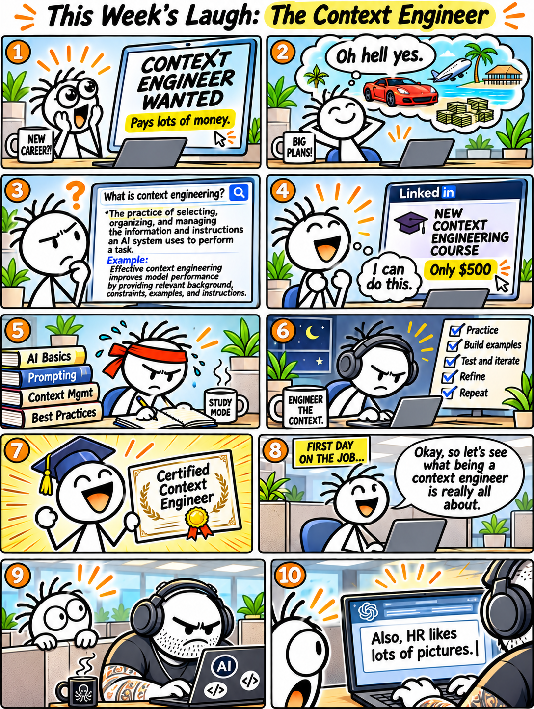

# If I Could, Would You? Issue #4: Context Management

_Published 2026-11-19 on LinkedIn. Text copied from the published edition. The comic is an image on LinkedIn; it is in [`../assets/issue-04/`](../assets/issue-04). The cover is in [`../covers/`](../covers/issue-04-cover.png)._

Okey dokey, week 4 of this thing. Not sure if anyone is reading this yet, but if you are, let me tell you a story.

About 8 months ago, I went to a networking lunch for the first time in my life. I didn't know what to expect. I just knew I wanted to change my career.

At the time, my idea was to learn enough of the technical stuff and then become the bridge between sales and IT so that they could finally use AI for stuff that actually gets people excited to sell more, instead of making them worry about getting in trouble.

So I hopped in my car super excited about telling people about my idea.

Then the guy who I was supposed to learn how to break into the training and development industry from told me it doesn't really matter what degree I have or certificate I grab, it's really all about who you know.

And the guy I was supposed to learn about how to use AI from so I could lift up my fellow sales reps? He told me that he didn't think there would even be people doing phone work anymore in 6 months, that anyone who got into AI now, would be able to write their ticket in 6 months, and that if I wanted to know where to start, I should look up a guy named [Dan Martell](https://www.linkedin.com/in/dmartell/) because he "was giving away all the secrets."

And then the person who I had spent the most time planning to speak with strolled out before I got up the nerve to talk to him.

So I took a deep breath and chased after this dude in the parking lot like some sort of lunatic and I don't even know what I said, or how crazy I came off, but somehow I ended up getting his number. And then later, after accidentally texting him my date night plans (that I intended to go to the amazing and stunning [Brittany Ammer](https://www.linkedin.com/in/brittanyammer/)), which is truly embarrassing given he didn't have the "context" that it was meant for my wife, he left me with this gem:

"Finding the marriage of what you have been doing and how to use AI to revolutionize it - that is a ticket writer."

So now it's 8 months later and if there was ever a ticket, I must have forgotten to bring something to write with for about the billionth time in my life. Somehow, I'm still making outbound calls to solicit timeshare tours and every sales leader I've asked "how long until we get replaced?" has looked at me like I'm nuts. And I've met a whole lot of impressive people I would normally avoid embarrassing myself in front of, but none of them seem to have a budget at the moment.

...And you know what, I think that might have been a tad bit too much context...

The point is [Dan Martell](https://www.youtube.com/@danmartell), people! Pay attention! And say what you want about the guy, but he certainly has a way of making AI seem accessible to everyone and he has his finger on the pulse when it comes to what the best stuff to use currently is. He's also turned me on to [Moonshots](https://www.diamandis.com/podcast) which I can't recommend enough.

But he did give me advice, that I'm a bit embarrassed to say, I never actually followed in the last 8 months. And that advice was on managing context.

I've spoken to you before about [what the context window is](https://www.linkedin.com/pulse/i-could-would-you-issue-2-steven-ammer-yzz5e). Now I'm gonna give you the same advice I haven't followed yet: instead of starting from scratch every conversation, or depending on your AI's memory way too much like I do, make yourself context files: on you, your job, and each part of your life.

Now you could start off by trying to tell your AI every rule you have in your head or you can do what ol' Dan told me and tell that genius in your pocket what you're trying to do and have it interview you to create a master context file.

And then just answer the questions however you like. If you don't like one, skip it. Heck, tell it why you did like it. If your fingers get tired, press the microphone button almost all chat interfaces have now and talk to it. If you think of something else while answering a question, just say it. You're dumping all of your information and letting the AI organize it.

And I can't say I personally use it very often because nothing seems to come out of my head the way I intend it when I'm actually speaking aloud, but for most people [Wispr Flow](https://wisprflow.ai/) is a complete game changer. And what's more, it's super user friendly to install. I've created a [guide here](https://if-i-could-issue-4.netlify.app/wispr-flow-guide/) that honestly is a bit more complicated than just downloading the app and following their intuitive instructions. But basically, you get it running on your phone and every single text box you click on, websites, text messages, email, your note taking app, brings up a little button. And when you press that button, you can pretty much sound like [Boomhauer](https://www.youtube.com/watch?v=x5W0emnIq8g) and it will somehow grab everything, organize it, and turn it into something that makes sense.

Quick context tips to try (Only attempt after you have made the master one. Don't be an Ammer):

1. Get a file at the end of every conversation to bring to the next one and start new chats regularly.
2. Every time it does something you hate, like an em dash or not searching before answering, tell it to knock it the heck off, commit it to memory if you want, and have it update your master context file with the new rule.
3. Have it list all its assumptions before proceeding. When you have the time, have it ask you questions until it's certain it has all the information it needs to complete the task. Then have it list its new assumptions based off your corrections.
4. Make it be critical of the whole thing. Have it analyze it from different perspectives. Get all the bad with the good in the context. Have it do critical passes on your main context file regularly. AI will fix a lot of its own context if you let it.

## TL/DR

**Interactive Explainer: [The Context Vision Quest](https://if-i-could-issue-4.netlify.app/)**

## The poll toll

If you didn't do the TL/DR lesson and you've hung in with me this far, you gotta pick one to continue.

**What level of context are you willing to give your AI?**

- Level 0: I like you, Steven, but I'm not talking to Skynet.
- Level 1: No context. I ask question it gives me answers. It doesn't need to know anything about me.
- Level 2: Co-worker. It knows all about your work life and just enough about the rest of your life to say, "we like to think of our team as a family here" without making you cringe too hard.
- Level 3: Friend. It knows most of the things going on in your life, but not how you really feel about all of it. And nothing too private.
- Level 4: Intimate. It knows you on level only your spouse or a loved one would. It knows your thoughts, your psychology, what you fear, really anything you feel like telling it and lots of things you would rather it not tell others.
- Level 5: Plugged into the Matrix: you would have it always listening to you, always seeing what you see, heck you wish it could read your thoughts to make things easier.

**Vote here:** [the poll post on LinkedIn](https://www.linkedin.com/feed/update/urn:li:activity:7528857400297226240/)

## Word of the Week: Context Engineering

**Definition:**

> “the set of strategies for curating and maintaining the optimal set of tokens (information) during LLM inference”

Source: [Anthropic, Effective Context Engineering for AI Agents](https://www.anthropic.com/research/effective-context-engineering-for-ai-agents)

**Used in a “sentence”:**

> “Context engineering aligns with several broader design trends for AI systems, like agentic architecture, tool-augmented reasoning, long-context LLMs, and retrieval-augmented generation.”

Source: [Discover Artificial Intelligence](https://link.springer.com/article/10.1007/s44163-026-02312-x)

**In Plain Ammer:** It's just managing the information the AI gets to work with.

You are pretty safe to just ignore the scary word engineering and replace it with management in your head every time you see it from here on out I think.

See also: [What Is Engineering? Crash Course Engineering #1](https://www.youtube.com/watch?v=btGYcizV0iI)

## A Dose of Optimism

Imagine if we took all those satellites floating around up there in space and used them to take pictures of the Earth every day. Then imagine we used AI to find patterns in the pictures. What kind of amazing things can we accomplish when the context isn't our language, but the Earth itself?

One immediate reason this matters is the potential to predict droughts and lower food costs. [Rwanda is already working with Planet on this issue.](https://www.planet.com/pulse/embracing-digital-transformation-in-africa-planet-and-the-government-of-rwanda-launch-national/) You should [check out what Planet and Will Marshall are up to](https://youtu.be/_XCKwH9S3fQ?is=ajk3-blD8fHpo7c4). [You can even play with the satellite search yourself!](https://ai.planet.com/)

## A Dash of Pessimism

Earlier this week, we all know Microsoft 365 went down. I'm not gonna speculate on whether AI had something to do with it or not, but if you're trying to build your AI agents, you should pay attention to this: this week, somebody snuck an [infected copy of Microsoft's own agent toolkit](https://www.wiz.io/blog/malicious-version-of-microsofts-agent-framework-published-to-pypi) onto the internet. This particular toolkit gets about 40,000 downloads a week and the bad copy was up for under an hour. And this particular virus didn't even require anyone to point their AI at the file. Simply booting up Python, one of the most common languages for building agents, automatically went looking for the passwords and keys to your AI.

## This Week's Offering to the Throne

And for this week's offering to the throne, here's [Key & Peele showing you exactly what reading the exact same chat window with the wrong context engineering can do](https://www.youtube.com/watch?v=naleynXS7yo).

## This Week's Laugh: The Context Engineer

## Wrap-up

So this week, go and be intentional about the information and the details you give your AI. If you want to make a master context file, make one. If you feel like AI has always seemed boring and generic to you, find a way to right that wrong.

Think about what a prompt is. You're providing the beginning of the conversation, and prompting your AI to fill in the rest. The better your introduction to your story, the better the ending is gonna sound.

Make that context window count!
